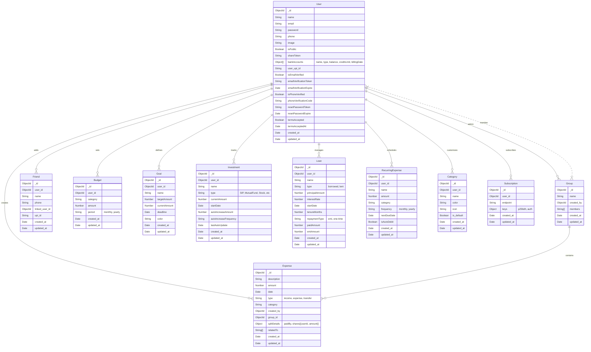

# 📘 Smart Expense Tracker - Master Documentation

> **Note:** This document combines both the User Guide and Technical Reference. You can copy and paste this entire content directly into a Notion page, and it will automatically format itself.

---

# Part 1: Application Overview

## 1. Project Overview
**Smart Expense Tracker** is a modern, feature-rich web application designed to help users manage personal finances, track expenses, split bills with friends, and visualize spending habits.

## 2. Key Features

### 💰 Expense Management
- **Transactions:** Add Income, Expenses, or Transfers.
- **Categorization:** Custom categories with icons.
- **Voice Support:** Add expenses using voice commands (e.g., "Spent 50 dollars on groceries").

### 🤝 Social & Splitting
- **Groups:** Create groups for shared expenses (e.g., "Trip to Vegas").
- **Friends:** Add friends to easily split bills.
- **Split Methods:** Equal, Exact Amount, or Percentage.

### 📈 Analytics
- **Dashboard:** Real-time overview of Balance, Income, and Expenses.
- **Charts:** Monthly spending trends and category breakdowns.

### 🛠 Tools
- **PWA Support:** Installable on mobile devices with offline capabilities.
- **Export:** Download data as Excel or PDF.
- **Recurring Expenses:** Manage subscriptions.

---

# Part 2: Technical Reference

## 1. System Architecture
The application follows a **Client-Server** architecture using Next.js.
- **Frontend:** React (Next.js App Router).
- **Backend:** Next.js API Routes (Serverless).
- **Database:** MongoDB (Mongoose ODM).
- **State:** React Context API + SWR.

### Data Flow Overview
1.  User Action (UI)
2.  API Call (`/api/*`)
3.  Server Authentication (JWT)
4.  Database Query (MongoDB)
5.  UI Update (SWR/Context)

## 2. Technology Stack
- **Framework:** Next.js 16 (React 19)
- **Language:** TypeScript
- **Database:** MongoDB
- **Styling:** CSS Modules / Global CSS Variables
- **Auth:** JWT (HTTP-Only Cookie)

## 3. Database Schema

### 👤 User Model
| Field | Type | Description |
| :--- | :--- | :--- |
| `name` | String | Full Name |
| `email` | String | Unique Email |
| `password` | String | Bcrypt Hash |
| `bankAccounts` | Array | Embedded accounts |

### 💸 Expense Model
| Field | Type | Description |
| :--- | :--- | :--- |
| `amount` | Number | Value |
| `type` | String | income/expense/transfer |
| `category` | String | Category Name |
| `splitDetails` | Object | `{ paidBy, shares: [] }` |

### 👥 Group & Friend Models
- **Group:** Collection of User IDs + Metadata.
- **Friend:** Lightweight contact entity linked to a User.

## 4. API Specification

### Authentication
- `POST /api/auth/register` - New User
- `POST /api/auth/login` - Login (Returns HTTP-Only Cookie)
- `GET /api/user/profile` - Get Session User

### Expenses
- `GET /api/expenses` - List all expenses
- `POST /api/expenses` - Create new
- `DELETE /api/expenses/:id` - Remove

## 5. Security Implementation
- **JWT:** Signed with `HS256`, stored in HTTP-Only cookies to prevent XSS.
- **Middleware:** Validates session before access to protected routes.
- **Validation:** Mongoose schemas ensure data integrity.

---

# Part 3: Setup Guide

### Prerequisites
- Node.js (v18+)
- MongoDB Connection String

### Installation
1.  **Clone & Install**
    ```bash
    git clone <repo>
    npm install
    ```
2.  **Environment Variables (`.env.local`)**
    ```env
    MONGODB_URI=mongodb://...
    JWT_SECRET=secret
    ```
3.  **Run**
    ```bash
    npm run dev
    ```

---

# Part 4: Database Diagrams

## Entity Relationship Diagram (ERD)


